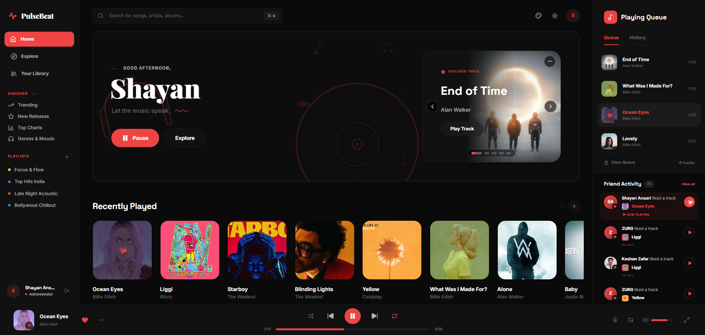
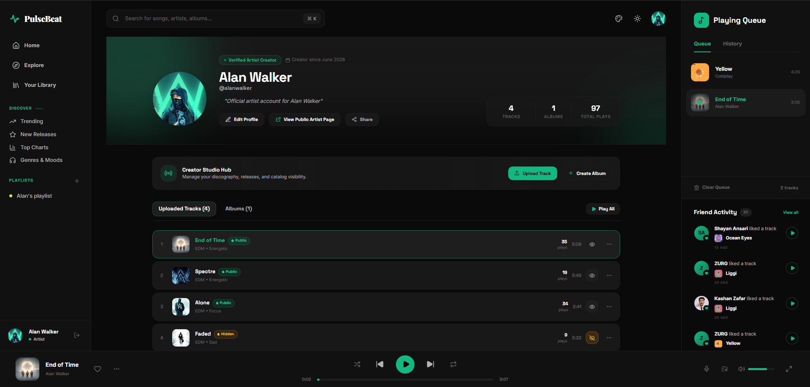
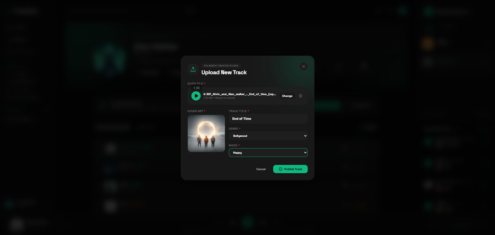
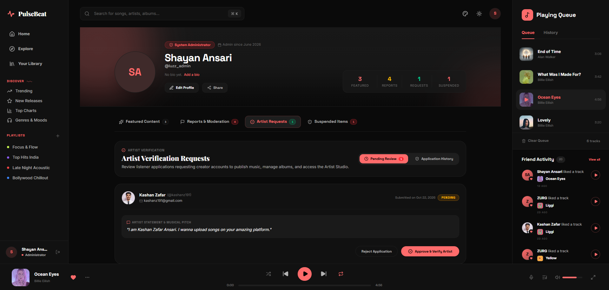
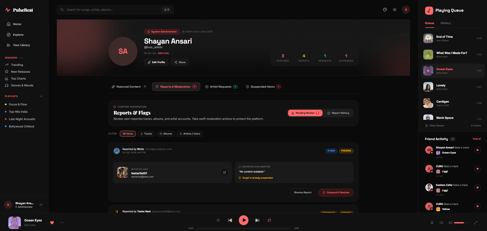
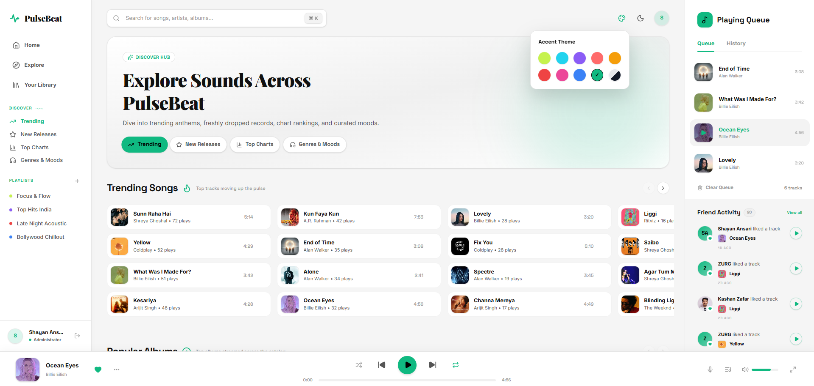
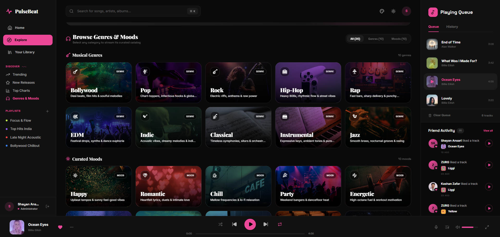
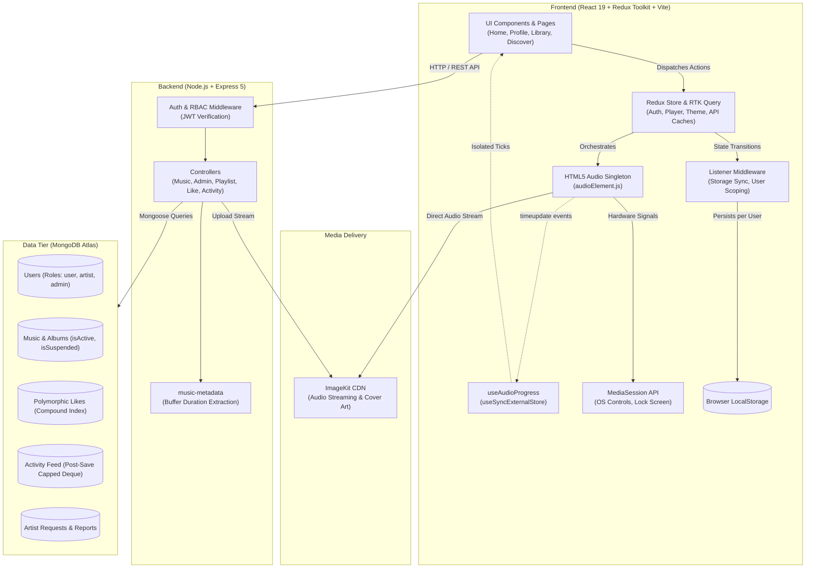

# PulseBeat

**A full-stack, multi-role music platform uniting listener discovery, creator publishing workflows, and administrative governance.**

[](https://pulsebeat-eight.vercel.app)
[](https://pulsebeat-api-fii6.onrender.com/api)
[](https://react.dev)
[](https://redux-toolkit.js.org)
[](https://nodejs.org)
[](https://www.mongodb.com)

**Live Application:** [pulsebeat-eight.vercel.app](https://pulsebeat-eight.vercel.app/?demo=guest) *(1-Click Instant Guest Demo)*  
**API Endpoint:** [pulsebeat-api-fii6.onrender.com/api](https://pulsebeat-api-fii6.onrender.com/api)

---

## Project Overview

PulseBeat is a production-oriented web platform built on the MERN stack that connects the complete audio content lifecycle. Rather than focusing solely on consumer playback, PulseBeat models the operational coordination between three distinct user personas: **Listeners**, who discover, stream, and curate music; **Artists**, who apply for verification, upload original audio, bundle releases into albums, and monitor catalog engagement; and **Administrators**, who moderate content, manage artist verification requests, audit platform abuse reports, and curate featured platform releases.

The platform emphasizes sound software engineering practices: strict role-based access control (RBAC), decoupled audio engine architecture with high-frequency render isolation, polymorphic data modeling, capped history collections, and user-namespaced state persistence.

---

## Product Showcase

### 1. Listener Experience & Continuous Audio Playback

*Dynamic hero release carousel, recently played feed, live playing queue, friend activity sidebar, and persistent global audio player.*

---

### 2. Artist Creator Hub & Publishing Pipeline
<p align="center">
  
  
</p>

*Left: In-profile Creator Studio Hub showing catalog performance analytics, play counts, and individual track visibility toggles (`isActive`). Right: Multipart audio upload pipeline with client-side audio preview, genre/mood taxonomy, and binary metadata extraction.*

---

### 3. Administrative Governance & Moderation Control Plane
<p align="center">
  
  
</p>

*Left: Artist application verification queue with 1-click Approve / Reject actions and submission cooldowns. Right: Community abuse report triage board with user/content suspension management.*

---

### 4. Personalization Engine & Multi-Dimensional Discovery
<p align="center">
  
  
</p>

*Left: Light mode showcasing real-time accent-color palette switching with dynamic contrast calculation. Right: Categorized music exploration across 10 musical genres and 10 emotional mood filters.*

---

## Standout Engineering Features

### 1. Multi-Role Platform & Content Lifecycle
PulseBeat models the end-to-end journey of music from creation to consumption:
- **Listener Role (`user`)**: Explores music across genres and moods, organizes personal playlists, likes content, inspects friend activity feeds, and streams tracks through a continuous global audio player.
- **Creator Role (`artist`)**: Manages a dedicated artist profile and Creator Hub, tracks aggregate catalog plays, publishes single tracks with automated duration extraction, and compiles songs into unified albums.
- **Administrator Role (`admin`)**: Exercises platform-wide governance via a dedicated control plane—evaluating creator applications, resolving content abuse reports, suspending malicious accounts, and curating hero showcases.
- **Unified Auth Pipeline**: A stateless JWT authentication architecture supporting cookie-based credentials and `Authorization: Bearer <token>` fallback headers, verified through custom middleware (`authenticateUser`, `authenticateArtist`, `authenticateAdmin`).

```
[ Listener ] ──( Applies for Verification )──> [ Admin Review Queue ]
                                                        │
                                                 (Approves Role)
                                                        ▼
[ Listener ] <──( Discovers & Streams )── [ Artist Creator Hub ]
      │                                         │
      └──( Reports Abuse )──> [ Admin Moderation ] ──( Suspends / Hides )
```

---

### 2. Artist Creator Hub
The Creator Hub embeds production-grade publishing tools directly into the artist's profile:
- **Audio & Visual Asset Upload Pipeline**: Accepts multipart uploads (`multer.memoryStorage()`) for both audio and high-resolution cover artwork. Audio buffers are parsed on the fly using `music-metadata` to calculate exact playback duration before streaming assets to ImageKit CDN storage.
- **Relational Album Compilation**: Enables artists to group existing published tracks into an album. The backend validates MongoDB ObjectId formats, performs ownership verification queries (`musicModel.countDocuments`), and executes atomic two-way synchronization between the `Album` record and linked `Music` documents.
- **Catalog Visibility Controls**: Artists can toggle individual tracks and albums between **public** and **hidden** (`isActive`). Visibility queries ensure hidden tracks are immediately excluded from public search and home feeds without destructive data deletion.
- **Governance Hierarchy**: Moderation overrides artist control. If an administrator suspends a track or artist account (`isSuspended: true`), the creator cannot toggle visibility or upload new music until the suspension is resolved.

---

### 3. Administrative Moderation & Governance
PulseBeat implements platform governance tools to maintain content quality and safety:
- **Artist Verification Pipeline**: Listeners submit artist applications with verification statements. Admins evaluate applications in an approval queue, accepting (promoting the user role to `artist`) or rejecting with reviewer feedback. Applications feature a 24-hour rate-limiting cooldown to prevent submission spam.
- **Abuse Reporting Workflow**: Community listeners can report problematic tracks, albums, or accounts categorized by violation type (`spam`, `abusive`, `inappropriate`, `copyright`, `other`). Admins triage open reports and flag them as `resolved` or `dismissed`.
- **Granular Suspension System**: Admins can suspend accounts, individual songs, or entire albums. Suspended assets are indexed (`{ isSuspended: true }`) and systematically filtered out of all public discovery queries.
- **Featured Content Curation**: Admins pin standout releases to the primary home carousel, complete with ordering controls (`featuredOrder`) to direct user discovery.

---

### 4. Persistent Global Audio Engine
Persistent audio playback is one of the most technically demanding aspects of modern web applications. PulseBeat resolves this with an isolated architectural pattern:
- **Decoupled Audio Singleton**: The HTML5 `Audio` element is instantiated outside the React component tree and Redux store (`audioElement.js`). Storing DOM elements in Redux violates serializability; managing it in component state causes playback interruptions on page navigation.
- **High-Frequency Render Isolation**: Audio progress updates (`timeupdate`) fire approximately 4 times per second. Routing these ticks through Redux would trigger continuous app-wide re-renders. PulseBeat isolates progress into a custom hook (`useAudioProgress.js`) backed by React's `useSyncExternalStore`. Only the progress bar re-renders during playback; the rest of the application remains idle.
- **User-Namespaced Queue Persistence**: Player configuration (track queue, active index, volume, mute state, repeat mode, and shuffle order) is synchronized to `localStorage` through Redux Listener Middleware under user-scoped keys (`pulsebeat:player:${userId}`). Switching accounts cleanly resets the audio engine and hydrates the new user's saved queue.
- **Queue State & Shuffle Integrity**: Maintains both `queue` and an immutable `originalQueue`. Enabling shuffle runs a Fisher-Yates algorithm preserving the currently playing track at index 0; disabling shuffle restores the original sequence without loss of order.
- **Browser MediaSession API**: Registers native `navigator.mediaSession` metadata (track title, artist, 512x512 artwork) and binds hardware/lock-screen controls (`play`, `pause`, `nexttrack`, `previoustrack`) directly to Redux actions.

---

### 5. Music Discovery & Community Features
- **Dynamic Exploration**: Comprehensive discovery suite supporting genre classification, mood tagging, trending tracks/albums, and keyword search across artists, tracks, and playlists.
- **Polymorphic Likes System**: Allows users to favorite tracks, albums, and playlists through a single, unified database schema.
- **Recently Played Tracking**: Records playback history and exposes user listening sessions with deduplicated chronological ordering.
- **Social Activity Feed**: Captures platform milestones (track uploads, album releases, playlist additions, and likes), presenting a chronological community activity log.

---

### 6. API Architecture & Data Modeling
PulseBeat relies on an Express REST API backed by MongoDB Atlas and Mongoose:
- **Polymorphic References**: The `Like` collection pairs `targetType` (`'music' | 'album' | 'artist' | 'playlist'`) with an ObjectId `targetId`, guarded by a compound unique index:
  ```javascript
  likeSchema.index({ user: 1, targetType: 1, targetId: 1 }, { unique: true });
  ```
  This prevents duplicate likes and eliminates the maintenance overhead of distinct like collections.
- **Capped Deque Pattern via Mongoose Hooks**: The `Activity` collection employs an asynchronous `post-save` hook that counts documents per user. When activity exceeds 100 entries, it queries and bulk-deletes the oldest records, keeping storage bounded without external cron jobs.
- **Soft Deletion & Referential Integrity**: Permanent deletion of music and albums is disabled (`deleteMusic` returns `400`). Tracks referenced across playlists, user libraries, and activity logs remain structurally intact while being hidden from discovery via the `isActive` flag.
- **Lightweight Monitoring Endpoint**: A dedicated `/health` route returns runtime uptime and ISO timestamps without triggering database queries, enabling zero-overhead uptime pings.

---

### 7. UI Design System & Personalization
- **Modern Glassmorphic Dark UI**: Built with custom Tailwind CSS utility layers featuring subtle surface elevations, translucent backdrop filters, and consistent layout tokens.
- **Dynamic Accent Color & Text Contrast**: Users can select custom accent colors stored in Redux and persisted to local storage. An algorithmic contrast evaluator dynamically computes whether text overlaid on the chosen accent should be dark or light, satisfying accessibility standards.
- **Anti-FOUC Theme Hydration**: The active theme and dark-mode classes are applied to the root `<html>` element synchronously before the initial React render, eliminating visible theme flicker.

---

## Architecture Overview



---

## Technology Stack

| Domain | Technology | Purpose in PulseBeat |
| :--- | :--- | :--- |
| **Frontend Framework** | React 19 | Declarative UI, transition optimizations, modern hook primitives |
| **Build Tooling** | Vite 8 | Ultra-fast HMR and optimized production asset bundling |
| **State Management** | Redux Toolkit 2 | Global player queue, auth session, and dynamic theme state |
| **Data Fetching & Cache** | RTK Query | Declarative server querying, automatic caching, and optimistic mutations |
| **Styling & Icons** | Tailwind CSS 4, Lucide React | Curated dark-mode design system, glassmorphism, responsive grid |
| **Backend Runtime** | Node.js | Scalable asynchronous I/O execution environment |
| **Web Framework** | Express 5 | Modular routing, middleware pipelines, and REST API controllers |
| **Database & ODM** | MongoDB Atlas, Mongoose 9 | Schemas, compound indexes, post-save hooks, and polymorphic references |
| **Authentication** | JSON Web Tokens, bcryptjs | Stateless authorization, password hashing, and multi-role RBAC |
| **Media & Audio Engine** | ImageKit SDK, `music-metadata` | Audio streaming, image delivery, and buffer metadata duration extraction |
| **Deployment** | Vercel, Render | Frontend SPA edge delivery, containerized backend hosting |

---

## Selected Engineering Decisions

### 1. Decoupling the Global Audio Engine from Redux State
- **Problem**: Storing high-frequency playback position (firing every ~250ms via `timeupdate`) inside the Redux state tree forces continuous app-wide re-renders. Every component reading state—including large track lists, navigation bars, and modals—evaluates re-rendering, causing visible UI micro-stutters and increased CPU overhead.
- **Implementation**: The native HTML5 `Audio` element is maintained as a module-level singleton (`audioElement.js`). Playback progress is extracted via `useAudioProgress`, which binds to native events through React's `useSyncExternalStore`.
- **Trade-off**: The playback progress bar updates smoothly at native browser speed while completely isolating the rest of the application tree from high-frequency render passes.

### 2. State Side-Effect Isolation via Redux Listener Middleware
- **Problem**: Synchronizing playback state, authentication tokens, and dynamic CSS themes to `localStorage` through component-level `useEffect` hooks introduces race conditions, duplicate execution on component remounts, and scattered side-effect logic.
- **Implementation**: Replaced component effects with Redux Toolkit's `createListenerMiddleware`. State subscriptions listen for discrete changes (such as `auth.user` transitions or `player` state updates) and execute persistence routines centrally.
- **Trade-off**: Side effects execute exactly once per state transition regardless of which route or component is mounted, guaranteeing deterministic persistence and cleaner component trees.

### 3. User-Namespaced Playback Hydration
- **Problem**: Persisting queue state to a single static `localStorage` key causes state leakage on shared computers: logging into a different account would inherit the previous user's queue, position, and volume settings.
- **Implementation**: Keys are scoped dynamically to the authenticated user ID (`pulsebeat:player:${userId}`). The store's auth listener detects login transitions, hydrates that specific user's saved queue, and purges active playback on logout (`dispatch(resetPlayer())` and `audio.pause()`).
- **Trade-off**: Provides personalized, persistent playback sessions per account without burdening backend databases with transient queue position writes.

### 4. Enforcing Administrative Governance Over Creator Visibility
- **Problem**: If an artist can toggle a suspended track back to "public", platform moderation is compromised. Conversely, hard-deleting flagged tracks breaks playlists, history records, and friend feeds that reference the track's ID.
- **Implementation**: Adopted a dual-status system: `isActive` (artist-controlled public/hidden visibility) and `isSuspended` (admin-controlled moderation). All public feeds query `{ isActive: { $ne: false }, isSuspended: { $ne: true } }`. The artist visibility controller explicitly blocks toggling if `isSuspended === true`.
- **Trade-off**: Guarantees administrative enforcement without causing foreign-key or referential failures across user playlists and historical data.

---

## Local Setup & Development

### Prerequisites
- **Node.js** (v18.x or later)
- **npm** (v9.x or later)
- **MongoDB** instance (local daemon or free MongoDB Atlas cluster)
- **ImageKit** account (for media storage and streaming)

### 1. Clone the Repository
```bash
git clone https://github.com/ShayanZ27/pulsebeat.git
cd pulsebeat
```

### 2. Backend Configuration & Setup
Navigate to the `backend` directory and install dependencies:
```bash
cd backend
npm install
```

Create a `.env` file in the `backend` directory based on `.env.example`:
```env
PORT=3000
NODE_ENV=development
MONGO_DB_URI=mongodb+srv://<username>:<password>@cluster0.example.mongodb.net/pulsebeat?retryWrites=true&w=majority
JWT_SECRET=your_development_jwt_secret_key_here
CLIENT_URL=http://localhost:5173
IMAGEKIT_PUBLIC_KEY=public_your_imagekit_public_key
IMAGEKIT_PRIVATE_KEY=private_your_imagekit_private_key
IMAGEKIT_URL_ENDPOINT=https://ik.imagekit.io/your_imagekit_id
```

Start the backend development server:
```bash
npm run dev
# Server runs on http://localhost:3000
```

### 3. Frontend Configuration & Setup
Open a new terminal, navigate to the `frontend` directory, and install dependencies:
```bash
cd frontend
npm install
```

*(Optional)* Create a `.env` file in the `frontend` directory. In local development, leaving `VITE_API_URL` unset causes Vite's proxy (`vite.config.js`) to automatically route `/api` calls to `http://localhost:3000`:
```env
# Optional in dev; leave blank to use the Vite local proxy
VITE_API_URL=
```

Start the Vite development server:
```bash
npm run dev
# Application opens at http://localhost:5173
```

---

## Database Seeding (Optional)

PulseBeat includes automated seeding utilities in `backend/seeding/` to populate a clean database with test records:
- **Seed SuperAdmin Account**:
  ```bash
  cd backend
  node seeding/seed-admin.js
  ```
- **Seed Artists & Media Catalog**:
  ```bash
  cd backend
  node seeding/seed-artists.js
  node seeding/seed-music.js
  node seeding/seed-albums-playlists.js
  ```
*Note: Ensure your ImageKit and MongoDB credentials in `.env` are configured before running media seeding.*

---

## Deployment Architecture

PulseBeat is deployed across production-grade cloud environments:

- **Frontend**: Hosted on **Vercel** with continuous deployment from `main`. Features single-page application (SPA) client rewrite rules (`vercel.json` and `_redirects`) to support direct deep-linking across nested routes.
- **Backend**: Hosted as a web service on **Render**. Node.js executes with dynamic port binding (`process.env.PORT`) and cross-origin security headers.
- **Database**: **MongoDB Atlas** M0/Serverless multi-tenant cluster with indexed collections.
- **Media CDN**: **ImageKit** serving optimized audio streams and responsive artwork.

> **Production Note on Free-Tier Hosting**: The backend API is hosted on Render's free tier, which spins down web services after periods of inactivity. An initial request after dormancy may experience a 30–50 second cold-start latency while the container boots. A lightweight `/health` endpoint is integrated for uptime pinging services (e.g. UptimeRobot) to maintain container readiness.

---

## Future Engineering Roadmap

- [ ] **Web Audio API Visualizer**: Connect the audio engine to a real-time `AnalyserNode` frequency visualizer for high-fidelity audio spectrum graphs.
- [ ] **Waveform Scrubbing**: Pre-generate audio waveform peak data during upload processing to enable visual timeline seeking.
- [ ] **WebSockets for Activity Broadcasts**: Migrate friend listening activity and collaborative playlists from polling to bidirectional WebSocket connections.
- [ ] **Automated Integration Testing**: Implement end-to-end user journey test suites using Playwright covering the full artist application and publishing cycle.

---

## Engineering Scope

PulseBeat was designed to go beyond typical client-side streaming clones by tackling the full lifecycle of audio platform engineering: robust authentication, strict multi-role authorization hierarchies, un-interrupted audio playback architecture, defensive data modeling, and end-to-end creator and moderation workflows.

Developed by **Shayan Ansari**.
